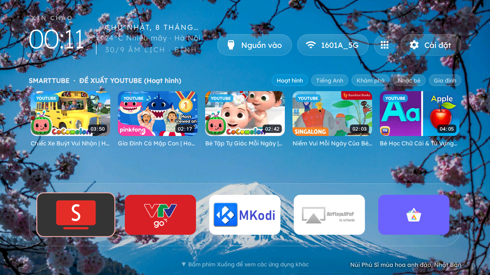
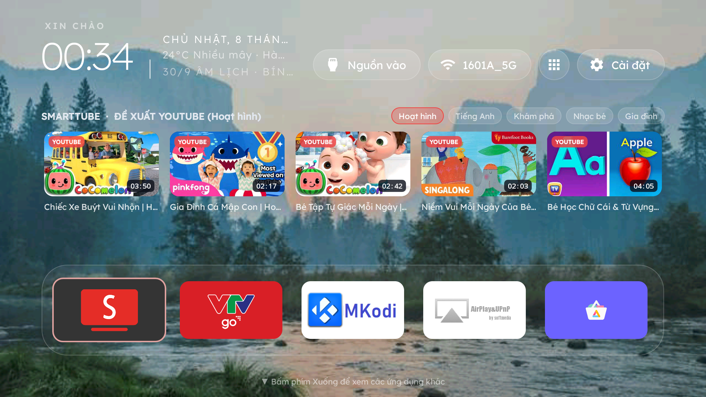
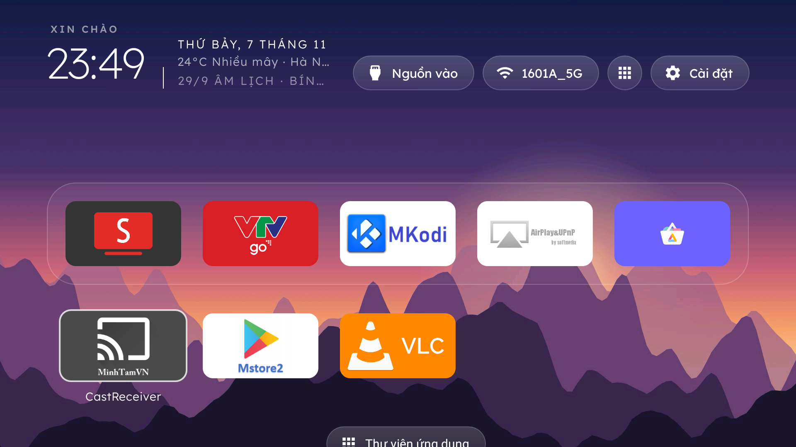

# TQD-TV — Hệ Sinh Thái Màn Hình Chính & Điều Khiển Thông Minh Từ Xa Cho Smart TV (Android 6+)

**`TQD-TV`** là phiên bản hợp nhất và nâng cấp toàn diện từ 2 dự án mã nguồn mở [`vgscity/vgs-cleantv`](https://github.com/abm-dungtq/vgs-cleantv) ([`Gathin23/cleanyourtv`](https://github.com/abm-dungtq/cleanyourtv)) và [`qqwersde/my-tv-signal-android6`](https://github.com/abm-dungtq/my-tv-signal-android6), được thiết kế tối ưu cho **Xiaomi Mi TV 4A (Android 6.0.1 / API 23)** và các dòng Android TV gia đình.

---

## 📸 Hình Ảnh Thực Tế Trên Màn Hình Mi TV 4A

| Vịnh Hạ Long (Phong cảnh thế giới tự đổi) | Núi Phú Sĩ (Chú thích địa danh góc phải dưới) |
| :---: | :---: |
|  |  |

| Ảnh tải lên từ Điện thoại qua `tv.tqd.me` | Bấm phím Xuống (`▼`) mở Ngăn kéo Ứng dụng |
| :---: | :---: |
|  |  |

---

## ✨ Các Tính Năng Cốt Lõi Của `TQD-TV`

1. **Giao Diện Màn Hình Chính 5 Icon Thoáng Đãng (`MainActivity.java`)**:
   - Thanh Dock kính mờ chỉ hiển thị đúng **5 ứng dụng chính** (`SmartTube`, `VTV Go`, `MKodi`, `AirPlay&UPnP`, `Aurora Store`).
   - Bấm phím **Xuống (`▼`)** trên điều khiển để mở ngăn kéo chứa các ứng dụng phụ.
   - Đã loại bỏ hoàn toàn quảng cáo hệ thống và dòng chữ thừa ở chân màn hình.
2. **Kệ Đề Xuất Video YouTube Trực Tiếp Trên Màn Hình Chính (`YoutubeShelf.java`)**:
   - Thay thế thanh kênh truyền hình cũ (`U1`) bằng kệ đề xuất video YouTube có ảnh bìa lớn sắc nét, chọn lọc theo 5 chủ đề (**Hoạt hình, Tiếng Anh, Khám phá, Nhạc bé, Gia đình**) hoặc nhập chủ đề tùy ý từ điện thoại; bấm vào phát ngay trên **SmartTube** không quảng cáo.
3. **Hình Nền Danh Thắng Thế Giới Tự Đổi & Tải Ảnh Từ Điện Thoại (`WallpaperPlayer.java`, `WebRemoteServer.java`)**:
   - Tích hợp sẵn **8 bức ảnh nhiếp ảnh 16:9 HD** của các danh thắng nổi tiếng thế giới (Vịnh Hạ Long, Núi Phú Sĩ, Dãy Alps Thụy Sĩ, Hồ Moraine Canada, Yosemite Mỹ, Stockholm Thụy Điển, Bắc Cực Quang Abisko) tự động xoay vòng mỗi phút kèm tên địa danh ở góc dưới bên phải.
   - Hỗ trợ **chọn ảnh bất kỳ từ điện thoại làm hình nền Tivi** (`📷 Chọn Ảnh Từ Điện Thoại Làm Hình Nền TV`) và nút **`⏭ Đổi Cảnh Kế Tiếp`** hoạt động tức thì trên cả Wi-Fi nội bộ lẫn 4G/5G (`https://tv.tqd.me`).
4. **Điều Khiển Từ Xa Qua Mạng Nhà (`:8686`) & Qua 4G/5G Toàn Cầu (`https://tv.tqd.me`)**:
   - Tích hợp máy chủ HTTP nội bộ (`http://<IP-TV>:8686`) và đường hầm **Cloud MQTT (`broker.emqx.io`)** kết nối với Cloudflare Worker **`https://tv.tqd.me`**.
   - Điều khiển D-Pad, Bàn rê cảm ứng (Touchpad), Chỉnh âm lượng, Gõ chữ tiếng Việt có dấu, Dọn Cache & giải phóng RAM 1 chạm.
5. **Theo Dõi Con Đang Xem Gì & Quản Lý Giờ Xem (`NowPlayingMonitor.java`, `ParentalControlManager.java`)**:
   - Biết chính xác tên video YouTube con đang xem và đang phát đến phút thứ mấy.
   - Gửi lời nhắn của bố mẹ hiện nổi lên màn hình Tivi, hẹn giờ đếm ngược tắt Tivi (`3p / 5p / 10p / 15p / 30p`), lịch tự khóa giờ ngủ (`21:30 → 06:30`), hoặc **Tắt & Khóa từ xa**.
6. **Giữ ADB Luôn Bật (`Persistent ADB Keeper`) & Cầu Nối Phím Giọng Nói Bluetooth (`scanCode=63`)**:
   - Tự động giữ `adb_enabled=1` và cổng TCP `5555` luôn bật sau mỗi lần khởi động lại Tivi.
   - Xử lý trực tiếp phím Mic phần cứng (`scanCode=63`) trên điều khiển Bluetooth Xiaomi chuyển sang Google Voice Search (`com.google.android.katniss`).

---

## 🗂️ Cấu Trúc Thư Mục

```text
tqd-tv/
├── launcher/                         # Mã nguồn Android Launcher (Java, minSdkVersion 23 - Android 6+)
│   └── app/src/main/
│       ├── assets/themes/world/      # 8 ảnh danh thắng thế giới 16:9 HD + captions.txt
│       └── java/com/gathin/tvhome/
│           ├── MainActivity.java           # Giao diện 5 icon + Ngăn kéo phím Xuống + Kệ YouTube
│           ├── YoutubeShelf.java           # Kệ đề xuất video YouTube theo chủ đề
│           ├── WallpaperPlayer.java        # Trình xoay vòng ảnh nền thế giới & chuyển cảnh tức thì
│           ├── WallpaperCaptions.java      # Đọc chú thích địa danh tương thích Android 6 (API 23)
│           ├── WebRemoteServer.java        # Máy chủ Web Remote (:8686) + Upload ảnh + 9 Themes
│           ├── CloudTunnelClient.java      # Đường hầm MQTT 4G/5G kết nối https://tv.tqd.me
│           ├── ParentalControlManager.java # Cảnh báo, đếm ngược, khóa/mở khóa & giữ ADB luôn bật
│           ├── NowPlayingMonitor.java      # Giám sát video SmartTube / ứng dụng đang phát
│           └── HomeKeyService.java         # Bắt phím Home & phím Mic giọng nói BLE (scanCode=63)
├── cloudflare-worker/                # Mã nguồn Cloudflare Worker cho https://tv.tqd.me
│   ├── extract-worker.py             # Script trích xuất HTML chuẩn UTF-8 từ WebRemoteServer.java
│   ├── worker.js                     # Worker phục vụ giao diện điều khiển từ xa https://tv.tqd.me
│   └── wrangler.toml                 # Cấu hình định tuyến custom domain tv.tqd.me
├── scripts/                          # Bộ kịch bản tự động hóa Build, Deploy & Khôi phục
│   ├── build-and-install.sh          # Biên dịch APK (minSdk=23) và cài đặt qua ADB
│   ├── deploy-cloudflare.sh          # Trích xuất HTML và deploy lên https://tv.tqd.me
│   ├── fix-voice-remote.sh           # Kiểm tra & kích hoạt cầu nối giọng nói điều khiển Xiaomi
│   └── restore-my-tv.sh              # Kịch bản khôi phục cài đặt gốc an toàn
├── docs/                             # Tài liệu quy trình & cẩm nang cho AI Agent
│   ├── STEP_BY_STEP_GUIDE.md         # Nhật ký chi tiết 10 bước đã thực hiện từ đầu đến cuối
│   ├── SMART_TV_AGENT_WORKFLOW.md    # Playbook tổng quát cho AI Agent xử lý mọi dòng Smart TV
│   └── screenshots/                  # Ảnh chụp màn hình thực tế từ Mi TV 4A
└── releases/
    └── tqd-tv-launcher-android6.apk  # File APK đã biên dịch sẵn, cài đặt được ngay bằng 1 lệnh ADB
```

---

## 🚀 Hướng Dẫn Cài Đặt Nhanh & Triển Khai

### 1. Cài đặt nhanh file APK đã biên dịch sẵn lên Tivi (Không cần build lại)

```bash
adb connect 192.168.100.4:5555
adb -s 192.168.100.4:5555 install -r releases/tqd-tv-launcher-android6.apk
adb -s 192.168.100.4:5555 shell "am start -n com.gathin.tvhome/.MainActivity"
```

### 2. Biên dịch từ mã nguồn & Cài đặt lên Tivi

```bash
./scripts/build-and-install.sh 192.168.100.4:5555
```

### 3. Cập nhật giao diện điều khiển từ xa lên `https://tv.tqd.me` (Cloudflare Worker)

```bash
./scripts/deploy-cloudflare.sh
```

---

## 📚 Tài Liệu Chi Tiết & Nguồn Gốc Fork

- **Nhật ký 10 bước thực hiện chi tiết**: [`docs/STEP_BY_STEP_GUIDE.md`](docs/STEP_BY_STEP_GUIDE.md)
- **Playbook dành cho AI Agent trên mọi dòng Smart TV**: [`docs/SMART_TV_AGENT_WORKFLOW.md`](docs/SMART_TV_AGENT_WORKFLOW.md)
- **Các kho mã nguồn gốc đã được Fork vào tài khoản `@abm-dungtq`**:
  - [`abm-dungtq/vgs-cleantv`](https://github.com/abm-dungtq/vgs-cleantv) (từ `vgscity/vgs-cleantv`)
  - [`abm-dungtq/my-tv-signal-android6`](https://github.com/abm-dungtq/my-tv-signal-android6) (từ `qqwersde/my-tv-signal-android6`)
  - [`abm-dungtq/cleanyourtv`](https://github.com/abm-dungtq/cleanyourtv) (từ `Gathin23/cleanyourtv`)
