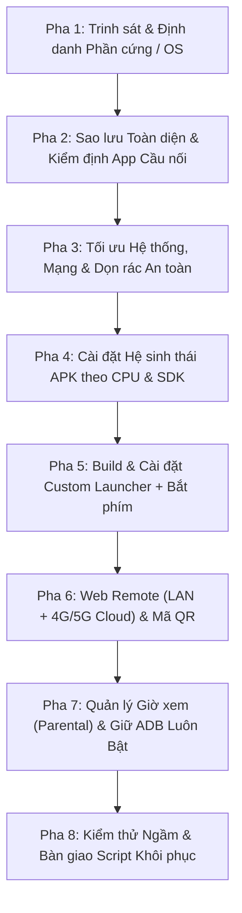

# Quy Trình Chuẩn Cho Agent: Tối Ưu Hóa Toàn Diện & Quản Lý Thông Minh Smart TV

> [!IMPORTANT]
> **NGUYÊN TẮC CỐT LÕI DÀNH CHO AGENT:**
> 1. **Một Quy Trình Chung — Nhiều Cách Thực Thi Riêng:** Mọi Smart TV đều phải đi qua **8 Pha Chuẩn Hóa** trong tài liệu này để đảm bảo không bỏ sót tính năng và tuyệt đối an toàn. Tuy nhiên, **cách thực thi cụ thể ở từng bước (Lệnh hệ thống, Cổng điều khiển, Phím phần cứng, Nhánh SDK, Nguồn HDMI)** bắt buộc phải dựa vào kết quả **Trinh sát Thực tế ở Pha 1** và **Ma trận Thích ứng Dòng TV ở Mục II**.
> 2. **Tuyệt Đối Không Suy Diễn (PDCA):** Không áp dụng danh sách gỡ app tĩnh hay câu lệnh của TV này sang TV khác khi chưa chạy lệnh kiểm tra thực tế trên thiết bị.
> 3. **Không Làm Gián Đoạn Người Đang Xem (Zero-Interruption Rule):** Nếu trên TV đang có người nhà hoặc trẻ nhỏ xem video, mọi thao tác cài đặt (`pm install -r`), cấp quyền (`pm grant`, `appops`, `settings`) và kiểm thử bắt buộc thực hiện ngầm 100% qua API/shell — **cấm gửi phím giả lập (`input keyevent`), cấm gọi `am start` đè lên màn hình, cấm bật popup thử nghiệm**.

---

## I. Kiến Trúc Tổng Thể 8 Pha (Universal Agent Workflow)

---

### Pha 1: Trinh Sát & Định Danh Thiết Bị (Recon & Device Fingerprinting)

Trước khi thay đổi bất kỳ cài đặt nào, Agent **bắt buộc** thu thập đầy đủ hồ sơ kỹ thuật của TV:

1. **Xác định địa chỉ IP và Hệ điều hành:**
   - Quét mạng LAN hoặc kết nối qua địa chỉ IP người dùng cung cấp (`<TV_IP>:5555`).
   - Nếu cổng `5555` đóng: Kiểm tra mDNS (`_adb-tls-connect._tcp` cho Wireless Debugging trên Android 11+) hoặc xác định xem TV có phải hệ điều hành đóng (Samsung Tizen, LG webOS, Roku, VIDAA) hay không.
2. **Trích xuất Hồ sơ Phần cứng & Hệ thống (Android TV / Google TV / MIUI TV / FireOS):**
   - **Model & Bo mạch:** `getprop ro.product.model`, `getprop ro.product.device`, `getprop ro.board.platform`, `getprop ro.product.brand`.
   - **Kiến trúc CPU (ABI):** `getprop ro.product.cpu.abi` và `ro.product.cpu.abilist` (`armeabi-v7a` 32-bit hay `arm64-v8a` 64-bit).
   - **Phiên bản Android & SDK:** `getprop ro.build.version.release` và `getprop ro.build.version.sdk` (Quyết định nhánh build APK và các API hệ thống được phép dùng).
   - **Tài nguyên Vật lý:** `cat /proc/meminfo` (`MemTotal`, `MemAvailable`), `df -h /data /system`, `top -n 1` (xác định tiến trình nào đang ngốn CPU/RAM).
3. **Khảo sát Dịch vụ Cầu nối & Cổng Nội bộ Đang Chạy:**
   - Đọc `settings get secure enabled_accessibility_services` và `settings get secure enabled_notification_listeners`.
   - Đọc `settings get secure default_input_method` (bàn phím hiện hành).
   - Kiểm tra các cổng điều khiển nội bộ của hãng đang lắng nghe trên loopback/LAN: `netstat -tulnp` hoặc `ss -tulnp` (ví dụ: cổng `6095` trên Xiaomi TV, dịch vụ Bluetooth RC, dịch vụ Miracast/AirPlay).
   - Kiểm tra các thuộc tính khởi động đặc biệt: `getprop | grep -iE "adb|voice|rc|hdmi|boot"`.

---

### Pha 2: Sao Lưu Toàn Diện & Kiểm Định App Cầu Nối (Backup & Bridge Audit)

1. **Khởi tạo thư mục `backup/` tại máy trạm:**
   - Lưu danh sách gói: `pm list packages -f`, `pm list packages -s`, `pm list packages -3`, `pm list packages -d`.
   - Lưu toàn bộ cấu hình: `getprop > backup/getprop.txt`, `settings list system`, `settings list secure`, `settings list global`.
   - Chụp ảnh màn hình trạng thái gốc: `screencap -p > shots/00-before.png`.
2. **Sao lưu và Kiểm định toàn bộ APK trong `/data/app/` (QUY TẮC SỐNG CÒN):**
   - Kéo toàn bộ file `.apk` trong `/data/app/` về `backup/apks/` trước khi gỡ bất kỳ ứng dụng nào.
   - **Cảnh báo ROM Việt hóa / ROM Mod nội địa:** Nhiều bản ROM TV nội địa (như Xiaomi, TCL nội địa) cài sẵn các **ứng dụng cầu nối (Bridge APK)** vào `/data/app/` nhưng **đặt trùng tên package của hãng** (ví dụ: `com.xiaomi.mitv.voicecontrol`, `com.mitv.*`) để không bị hệ thống chặn.
   - **Hành động bắt buộc:** Trước khi gỡ hoặc tắt bất kỳ gói nào trong `/data/app/` hoặc đang nằm trong `enabled_accessibility_services`, Agent phải chạy `dumpsys package <pkg>` và dịch ngược nhanh manifest/classes (`aapt dump badging` / `dexdump`) để biết gói đó là bloatware thật hay là cầu nối bắt phím giọng nói / phím Home phần cứng.

---

### Pha 3: Tối Ưu Hệ Thống, Mạng & Dọn Rác An Toàn (Safe Debloat & Network/Playback Tuning)

1. **Bảo vệ Bàn phím (Input Method Guard):**
   - Trước khi tắt bàn phím tiếng Trung/quảng cáo của hãng (như `com.sogou.ime.wear`, `com.baidu.input`), bắt buộc cài đặt và kích hoạt bàn phím tiếng Việt nhẹ cho TV (như **LeanKey Keyboard** `com.liskovsoft.leankeyboard`) làm mặc định qua `ime enable` và `ime set`.
2. **Dọn rác theo 3 tầng an toàn:**
   - **Tầng Tuyệt đối Không Đụng Chạm:** Các gói lõi Android (`android`, `com.android.systemui`, `com.android.settings`, `com.android.tv.settings`, `com.android.providers.*`, `com.google.android.katniss` [Google Voice Search], `com.google.android.gms`, `com.google.android.tungsten.setupwraith` nếu đang giữ cấu hình Wi-Fi, các gói `tvinput` / `hdmi` / `bluetooth` / `remote`). Tuyệt đối không bao giờ chạy các gói `factory` (`*factory*`, `com.cvte.tv.hkcfac`).
   - **Tầng Gói Hệ thống (`/system/app`, `/system/priv-app`):** Ưu tiên dùng `pm disable-user --user 0 <pkg>` kết hợp khóa `appops` (`WAKE_LOCK ignore`, `POST_NOTIFICATION ignore`, `RUN_IN_BACKGROUND ignore`).
   - **Tầng Gói Rác Tự Hồi Sinh (Respawning Push/Analytics Daemons):** Với các daemon quảng cáo/thống kê/push ngầm của hãng tự bật lại sau mỗi lần reboot và spam kết nối mạng liên tục (kiểm tra qua `top` và `netstat -tnp`, ví dụ `tvpushservice`, `analytics`, `statistic`, `devicereport`, `adservice`), sử dụng `pm uninstall --user 0 <pkg>` (sau khi đã lưu bản gốc và ghi vào script khôi phục `pm install-existing`).
3. **Tối ưu Mạng & Giải mã Video (Chống giật lag YouTube/SmartTube):**
   - **Tối ưu DNS:** Nếu router nhà hoặc DNS mặc định phản hồi chậm làm nghẽn luồng video, cấu hình DNS ưu tiên `1.1.1.1` và `8.8.8.8` cho giao diện mạng đang hoạt động (`wlan0` / `eth0`).
   - **Tắt Polling gây nghẽn:** Tắt HDMI-CEC polling nếu TV không dùng CEC và logcat báo lỗi lặp liên tục (`settings put global hdmi_control_enabled 0`).
   - **Tối ưu Giao diện & Hệ thống:** Chỉnh múi giờ `Asia/Ho_Chi_Minh`, tắt quảng cáo bật máy (`boot_ad_switch = 0`), đặt `window_animation_scale`, `transition_animation_scale`, `animator_duration_scale` về `0.5`.
   - **Kiểm chứng bằng số liệu phần cứng:** Kiểm tra `dumpsys media.player` / `/sys/class/vdec/vdec_status` / `dumpsys SurfaceFlinger`: đảm bảo `drop count = 0`, `hw err count = 0`, `Recv-Q = 0` và `MemAvailable` đạt mức tối ưu.

---

### Pha 4: Cài Đặt Hệ Sinh Thái Ứng Dụng Chuẩn (Curated App Stack)

Agent tự động tải và cài đặt các bản APK chính chủ, đúng kiến trúc CPU (`armeabi-v7a` hoặc `arm64-v8a`) và tương thích với `SDK` của TV:

| Nhóm nhu cầu | Ứng dụng khuyến nghị | Package Name | Lưu ý tương thích |
|---|---|---|---|
| **YouTube không quảng cáo** | **SmartTube Stable** | `org.smarttube.stable` | Chọn đúng bản `armeabi-v7a` cho TV 32-bit (Android 4.3+) hoặc `arm64-v8a` cho TV 64-bit. |
| **Truyền hình & Phim** | **VTV Go**, **Kodi / MKodi**, **Nova Video Player**, **VLC** | `vn.vtv.vtvgotv`, `org.courville.nova`, `org.videolan.vlc` | Kiểm tra `minSdk` của bản phát hành trước khi push; với Android 6 (SDK 23) cần chọn nhánh APK hỗ trợ API <= 23. |
| **Truyền file nội mạng** | **LocalSend** | `org.localsend.localsend_app` | Gửi APK, ảnh, video từ điện thoại/máy tính sang TV qua Wi-Fi không cần USB. |
| **Kho ứng dụng & Quản lý** | **Aptoide TV**, **Aurora Store**, **Simple File Manager Pro**, **TV Bro** | `cm.aptoidetv.pt`, `com.aurora.store`, `com.simplemobiletools.filemanager.pro`, `com.phlox.tvwebbrowser` | Giúp người dùng tự tải thêm ứng dụng và duyệt web bằng điều khiển TV. |

---

### Pha 5: Biên Dịch & Triển Khai Custom Launcher Tối Ưu (`com.gathin.tvhome`)

1. **Chọn nhánh mã nguồn & Cấu hình Build theo SDK:**
   - **TV chạy Android 8.0+ (`SDK >= 26`):** Sử dụng nhánh chuẩn `launcher/` (`minSdk 26`).
   - **TV chạy Android 5.0–7.1 (`SDK 21–25`):** Sử dụng nhánh tương thích kèm `coreLibraryDesugaringEnabled = true` và truyền cờ `-PlauncherMinSdk=<SDK>` (ví dụ: `-PlauncherMinSdk=23` cho Android 6.0).
2. **Cá nhân hóa Giao diện (`config.xml`):**
   - Thiết lập thanh Dock ưu tiên các ứng dụng gia đình hay dùng nhất (`SmartTube`, `VTV Go`, `Phim`, `Trình phát video`, `Kho ứng dụng`).
   - Bật Lịch Âm Việt Nam (`lunar_date = true`), hiển thị thông số phần cứng gọn nhẹ (`show_stats = true`), bật thư viện ứng dụng (`app_library = true`).
3. **Định tuyến Phím Phần cứng & Chuyển nguồn HDMI/AV (`HomeKeyService` / `InputKeyService`):**
   - **Bắt phím Home & Menu:** Chuyển hướng phím Home về Launcher mới ngay cả khi hệ điều hành của hãng khóa cứng phím Home về Launcher gốc.
   - **Bảo toàn & Tích hợp Phím Giọng nói (Mic):**
     - Luôn nối thêm (`append`) hoặc tích hợp trực tiếp logic bắt `scanCode` phím Mic của điều khiển vào `HomeKeyService` thay vì xóa trắng `enabled_accessibility_services`.
     - Với điều khiển Bluetooth có cơ chế **nhấn giữ để truyền âm thanh BLE**, đảm bảo chỉ gửi Intent `android.intent.action.WEB_SEARCH` (`com.google.android.katniss`) ở lần nhấn đầu tiên trong cửa sổ chờ (ví dụ 8 giây), **không gọi lại `startActivity` khi phím lặp lúc nhấn giữ** để không làm đứt phiên thu âm `AudioRecord`.
   - **Chuyển nguồn HDMI 1/2/3 & AV:** Gắn đúng Intent chuyển nguồn phần cứng của dòng TV đó (xem chi tiết tại **Mục II**).
4. **Quy tắc Home Guard:**
   - Cài đặt Launcher mới $\rightarrow$ Đặt làm màn hình chính (`cmd package set-home-activity com.gathin.tvhome/.MainActivity` hoặc chọn `Luôn luôn`) $\rightarrow$ Xác nhận `mFocusedApp` là `com.gathin.tvhome` $\rightarrow$ **Chỉ sau đó** mới tắt Launcher gốc của hãng.

---

### Pha 6: Tích Hợp Điều Khiển Bằng Điện Thoại — Nội Mạng LAN & Ngoại Mạng 4G/5G (`WebRemoteServer` + `CloudTunnelClient`)

Biến mọi chiếc điện thoại trong gia đình thành điều khiển thông minh mà không cần cài thêm app ngoài:

1. **Máy chủ Web Remote Nội mạng (`http://<TV_IP>:8686`):**
   - Chạy trực tiếp bên trong tiến trình nền bền vững của Launcher (`AccessibilityService`), tự động khởi chạy cùng TV và tự phục hồi socket nếu mạng đổi IP.
   - **Mã QR góc màn hình chính TV:** Tự động sinh mã QR (chuẩn ISO/IEC 18004) gắn ở góc trên bên phải màn hình chính TV (tự làm mờ/ẩn khi mở ứng dụng khác) để quét camera mở ngay trên điện thoại.
   - **Tính năng điều khiển đầy đủ:**
     - **D-Pad (Hỗ trợ nhấn giữ tự lặp Hold-to-Repeat)** & **Bàn rê cảm ứng (Touchpad)**.
     - **Cụm phím Media (`⏮ ⏪ ⏯ ⏩ ⏭`)** & **Thanh trượt âm lượng trực tiếp (`0–Max`)** qua `AudioManager`.
     - **Nhập liệu Tiếng Việt & Tìm kiếm nhanh:** Điền trực tiếp chuỗi Unicode tiếng Việt vào ô nhập đang mở trên TV qua `AccessibilityNodeInfo.ACTION_SET_TEXT` (`flagRetrieveInteractiveWindows` + `canRetrieveWindowContent="true"`) kết hợp `ClipboardManager`, hoặc bắn thẳng từ khóa/link sang `SmartTube`.
     - **Danh sách Ứng dụng Động (`/api/apps`):** Tự động quét và hiển thị toàn bộ ứng dụng có trên TV để mở 1 chạm từ điện thoại.
2. **Điều khiển & Giám sát từ bên ngoài mạng ở nhà (qua 4G/5G / Cơ quan):**
   - **Giao thức Cloud MQTT nhẹ (`CloudTunnelClient`):** Kết nối TCP/TLS từ TV tới MQTT Broker (`broker.emqx.io` / `broker.hivemq.com`), định danh theo `DEVICE_ID` riêng của TV (`agytv/<deviceId>/state` và `agytv/<deviceId>/cmd`).
   - **Bảo mật bằng Mã PIN:** Mọi lệnh gửi từ bên ngoài qua Cloud bắt buộc kèm mã PIN xác thực.
   - **Phát hành Giao diện PWA lên Tên miền HTTPS cố định (ví dụ `https://tv.<domain>` trên Cloudflare):** Tự động nhận diện khi điện thoại đang ở cùng Wi-Fi (gọi thẳng LAN `<5ms`) hay đang đi ra ngoài dùng 4G/5G (tự động chuyển sang WebSocket MQTT `wss://` mượt mà).

---

### Pha 7: Quản Lý Giờ Xem Cho Trẻ Nhỏ & Giữ ADB Luôn Bật (`MediaMonitorService` + `ParentalControlManager`)

Giải quyết bài toán quản lý con nhỏ xem TV từ xa một cách tâm lý, nhẹ nhàng nhưng triệt để:

1. **Theo dõi Trực tiếp "Con Đang Xem Gì Trên Tivi" (`MediaMonitorService`):**
   - Sử dụng `NotificationListenerService` (tự động bật qua `settings put secure enabled_notification_listeners`) kết hợp `MediaSessionManager.getActiveSessions()`.
   - Trích xuất thời gian thực từ `SmartTube` / ứng dụng phát video: **Tên video đang xem**, **Tên kênh / Lượt xem**, **Trạng thái (`🟢 ĐANG PHÁT` / `⏸ ĐANG DỪNG`)**, **Số phút đã xem / Tổng thời lượng**, đồng bộ liên tục lên điện thoại của phụ huynh (cả LAN và 4G/5G).
2. **Gửi Cảnh Báo Lên Màn Hình Tivi & Hẹn Giờ Tắt + Khóa Tạm:**
   - **Thanh thông báo nhẹ nhàng (`showBannerOverlay`):** Dùng `WindowManager` (`TYPE_ACCESSIBILITY_OVERLAY` trên Android 8+ hoặc `TYPE_TOAST` trên Android 6–7 với `FLAG_NOT_FOCUSABLE`) hiển thị lời nhắn tiếng Việt của Ba/Mẹ ở mép trên màn hình kèm âm báo nhẹ mà không làm văng hay dừng video của con.
   - **Đồng hồ đếm ngược góc phải (`⏳ Tắt sau 04:59`):** Khi phụ huynh bấm hẹn giờ (`3p`, `5p`, `10p`, `15p`, `30p` hoặc `+5p`), góc trên bên phải TV hiện đồng hồ đếm ngược trực quan; khi còn 60 giây cuối tự đổi sang màu đỏ và nhắc lại lời nhắn để con chuẩn bị tâm lý.
   - **Tắt màn hình & Khóa tạm khi hết giờ (`00:00` hoặc bấm `🔒 Tắt & Khóa`):**
     - Tự động dừng video (`KEYCODE_MEDIA_PAUSE`), đưa TV về chế độ nghỉ (`KEYCODE_SLEEP`) và bật cờ `locked = true`.
     - **Chống bật lại khi chưa xin phép:** Khi đang ở trạng thái khóa, nếu trẻ tự cầm điều khiển bật sáng lại TV và mở `SmartTube`, dịch vụ nền sẽ lập tức dừng video, đóng `SmartTube` về màn hình chính và hiện thông báo *"Đã hết giờ xem Tivi, hẹn con ngày mai nhé ❤️"* cho đến khi phụ huynh bấm **`🔓 Mở Khóa`** trên điện thoại.
3. **Tự động Giữ ADB Luôn Bật Sau Mỗi Lần Khởi Động Lại (`ensureAdbAlwaysOn`):**
   - Cấp quyền `pm grant com.gathin.tvhome android.permission.WRITE_SECURE_SETTINGS`.
   - Ngay khi `AccessibilityService` khởi chạy lúc bật TV, tự động ghi `Settings.Global.ADB_ENABLED = 1` và đăng ký `ContentObserver` lắng nghe `ADB_ENABLED` để bật lại tức thì nếu script khởi động của hãng cố tình tắt ADB.

---

### Pha 8: Kiểm Thử Thực Tế Không Gián Đoạn & Bàn Giao Bộ Khôi Phục (Verification & Restore Kit)

1. **Kiểm thử Cơ học Ngầm (Non-Intrusive Verification):**
   - Kiểm tra `GET /api/status` và gói tin Cloud MQTT trả về đầy đủ `adbEnabled: true`, `cloudConnected: true`, `nowPlaying`, `parental`.
   - Kiểm tra `dumpsys activity services com.gathin.tvhome` xác nhận cả `HomeKeyService` và `MediaMonitorService` đang chạy ổn định.
2. **Đóng gói Script Khôi phục (`restore-my-tv.sh`):**
   - Sinh script tự động bật lại các gói đã disable (`pm enable`), cài lại các gói đã gỡ (`pm install-existing` hoặc cài từ `backup/apks/`) và khôi phục Launcher gốc phòng khi người dùng muốn đưa TV về trạng thái xuất xưởng mà không cần Factory Reset.

---

## II. Ma Trận Thích Ứng Theo Từng Dòng Smart TV (Device-Specific Adaptation Matrix)

Khi bước vào **Pha 1**, tùy thuộc vào hãng sản xuất và hệ điều hành phát hiện được, Agent **áp dụng bảng chuyên biệt dưới đây**:

### 1. Xiaomi Mi TV / Redmi TV (MIUI TV / PatchWall — Android 6.0 đến Android 11)

| Hạng mục kỹ thuật | Cách xử lý đặc thù cho Xiaomi TV |
|---|---|
| **Nhận diện** | `ro.product.brand = Xiaomi`, `ro.product.device = matrix` / `missionimpossible` / `crow` / `once`..., giao diện gốc `com.mitv.tvhome`. |
| **Nhánh Build Launcher** | Đời Mi TV 3/4/4A chạy Android 6.0 (`SDK 23`, 32-bit `armeabi-v7a`): Bắt buộc build với `-PlauncherMinSdk=23` và bật `coreLibraryDesugaring`. Đời Mi TV P1/Q1/A2/S Pro (`SDK >= 26`): Build nhánh chuẩn. |
| **Bơm phím điều khiển tốc độ cao** | Xiaomi có sẵn daemon `MiTV Assistant Server` lắng nghe tại `http://127.0.0.1:6095/controller?action=keyevent&keycode=<up\|down\|left\|right\|enter\|back\|menu\|power\|volumeup\|volumedown>` (gọi thẳng vào `libEventInjector.so`, độ trễ `<5ms`). Ưu tiên gọi cổng `6095` trước, fallback sang `AccessibilityService` và `/system/bin/input keyevent`. |
| **Chuyển cổng HDMI / AV** | Gọi `ComponentName("com.xiaomi.mitv.tvplayer", "com.xiaomi.mitv.tvplayer.ExternalSourceActivity")` kèm cờ `input_source`: `23` (HDMI 1), `24` (HDMI 2), `25` (HDMI 3), `2` (AV). |
| **Tự động tắt ADB khi Reboot** | MIUI TV có thuộc tính `[sys.set_adb_disabled]: [true]` tự tắt `adb_enabled` về `0` mỗi lần khởi động. Bắt buộc kích hoạt `ParentalControlManager.ensureAdbAlwaysOn()` (`WRITE_SECURE_SETTINGS` + `ContentObserver`) để tự bật lại `adb_enabled = 1`. |
| **Xử lý lag mạng & CPU ngầm** | Sau mỗi lần reboot, gói `com.xiaomi.mitv.tvpush.tvpushservice` tự sống dậy và spam kết nối MQTT về `broker.mqtt.pandora.xiaomi.com` mỗi 2 giây gây nghẽn mạng. Bắt buộc gỡ (`pm uninstall --user 0`) cùng bộ `com.miui.tv.analytics`, `com.xiaomi.statistic`, `com.xiaomi.devicereport`, `com.miui.daemon`. |
| **Đặc thù Phím Giọng nói (Voice RC)** | Trên bản ROM Việt hóa (`matrix`), `/data/app/com.xiaomi.mitv.voicecontrol-1` là app cầu nối bắt `scanCode=63` (`keyCode=0` do thiếu mapping trong `Vendor_2717_Product_32b8.kl`). Ngoài ra HAL âm thanh `/system/lib/hw/audio.rc.amlogic.so` kiểm tra điều khiển BLE chính hãng (`Speech Recognizer must use Xiaomi RC`). Phải giữ/tích hợp logic bắt `scanCode=63` với cửa sổ chờ 8 giây (`!primedRecently`) để không làm ngắt phiên thu âm khi người dùng nhấn giữ nút Mic. |
| **Cửa sổ Overlay (Cảnh báo/Đếm ngược)** | Trên Android 6.0 (`SDK 23`), sử dụng `WindowManager.LayoutParams.TYPE_TOAST` (hoặc `TYPE_PHONE` kèm `appops set SYSTEM_ALERT_WINDOW allow`) với `FLAG_NOT_FOCUSABLE`. Trên Android 8.0+ (`SDK >= 26`), sử dụng `TYPE_ACCESSIBILITY_OVERLAY`. |

---

### 2. Sony Bravia, TCL, Hisense, Casper, Coocaa, Philips (Android TV / Google TV Chuẩn — Android 9 đến 14)

| Hạng mục kỹ thuật | Cách xử lý đặc thù cho Android TV / Google TV Chuẩn |
|---|---|
| **Nhận diện** | Giao diện gốc là `com.google.android.tvlauncher` (Android TV) hoặc `com.google.android.apps.tv.launcherx` (Google TV). |
| **Quy tắc SetupWraith (Giữ Wi-Fi)** | Trên Google TV, trước khi disable `com.google.android.tungsten.setupwraith`, **bắt buộc** chạy `dumpsys wifi \| grep -o 'cname=[^ ]*'`. Nếu mạng Wi-Fi đang lưu thuộc sở hữu của `setupwraith`, **tuyệt đối không disable** gói này (nếu disable sẽ làm TV rớt Wi-Fi và mất kết nối ADB ngay lập tức). |
| **Khóa Launcher Gốc** | Disable cả 2 gói: `com.google.android.tvlauncher` / `com.google.android.apps.tv.launcherx` **và** gói bảo vệ `com.google.android.tungsten.setupwraith` (khi đã kiểm tra an toàn Wi-Fi) sau khi Launcher mới đã nhận quyền `HOME`. |
| **Bơm phím điều khiển** | Không có cổng `6095` của Xiaomi. Sử dụng kết hợp: `AudioManager` cho Volume/Media (`<2ms`), `AccessibilityService.performGlobalAction` cho `BACK`/`HOME`/`RECENTS`, và luồng `Instrumentation` / `/system/bin/input keyevent` cho cụm phím D-Pad (`DPAD_UP/DOWN/LEFT/RIGHT/CENTER`). |
| **Chuyển cổng HDMI / AV** | Sử dụng chuẩn Android TV Input Framework (`TvInputManager`): liệt kê danh sách đầu vào qua `cmd media_session` / `dumpsys tv_input` và mở Intent `Intent.ACTION_VIEW` với URI `content://android.media.tv/passthrough/<inputId>`. |
| **Cửa sổ Overlay (Cảnh báo/Đếm ngược)** | Sử dụng trực tiếp `WindowManager.LayoutParams.TYPE_ACCESSIBILITY_OVERLAY` từ bên trong `HomeKeyService` (không cần xin quyền `SYSTEM_ALERT_WINDOW` riêng trên Android 8+). |

---

### 3. Smart TV Dùng Bo Mạch CVTE (JVC, Sharp, Asanzo, iFFALCON, Toshiba một số dòng)

| Hạng mục kỹ thuật | Cách xử lý đặc thù cho Bo mạch CVTE (`com.cvte.*`) |
|---|---|
| **Nhận diện** | Có sự xuất hiện của các gói `com.cvte.*` trong `pm list packages`. |
| **Cấm tuyệt đối** | **Không bao giờ khởi chạy gói `com.cvte.tv.hkcfac` hay bất kỳ gói `*factory*` nào**, kể cả chỉ để kiểm tra — trên bo CVTE lệnh này sẽ bật cờ Factory Mode không thể thoát bằng shell. |
| **Quy tắc Thay Launcher Chống Treo Logo** | **Không tắt Launcher gốc (`com.cvte.tv.launcher.*`) và không bật Accessibility Key Helper trong cùng một lượt trước khi reboot.** Quy trình bắt buộc: (1) Cài Launcher mới $\rightarrow$ (2) Chạy `cmd package set-home-activity com.gathin.tvhome/.MainActivity` $\rightarrow$ (3) Reboot TV 1 lần và xác nhận TV vào thẳng màn hình chính + ADB vẫn mở $\rightarrow$ (4) Lúc đó mới bật Accessibility Service và tối ưu tiếp. |

---

### 4. Amazon Fire TV / Fire TV Stick (FireOS — Android 7/9/11)

| Hạng mục kỹ thuật | Cách xử lý đặc thù cho FireOS |
|---|---|
| **Nhận diện** | `ro.build.version.fireos`, gói Launcher gốc `com.amazon.tv.launcher` / `com.amazon.firehomestarter`. |
| **Chặn phím Home của FireOS** | FireOS chặn `pm disable-user` đối với `com.amazon.tv.launcher` trên các bản firmware mới. Sử dụng `HomeKeyService` (`onKeyEvent` bắt `KEYCODE_HOME` trả về `true` và gọi `MainActivity`) kết hợp `ADB Always-On` để chuyển hướng mượt về Launcher mới. |

---

### 5. Samsung (Tizen OS) & LG (webOS) — Smart TV Không Chạy Android

| Hạng mục kỹ thuật | Cách xử lý đặc thù cho Tizen / webOS |
|---|---|
| **Nhận diện** | Không mở cổng ADB `5555`; mở cổng `8001`/`8002` (Samsung SmartView) hoặc `3000`/`3001` (LG webOS SSAP). |
| **Chiến lược thực thi** | Không cài APK Android. Agent chuyển sang: (1) Khởi tạo **Web Remote PWA** kết nối qua WebSocket `wss://<TV_IP>:8002/api/v2/channels/samsung.remote.control` (Samsung) hoặc `ws://<TV_IP>:3000` (LG webOS) để điều khiển, đọc ứng dụng đang mở và hẹn giờ tắt (`ssap://system/turnOff`); (2) Chặn tên miền quảng cáo/tracking của Samsung/LG trực tiếp qua cấu hình DNS (AdGuard DNS / NextDNS) trên TV hoặc Router. |

---

## III. Checklist Nghiệm Thu Bắt Buộc Trước Khi Báo Cáo Hoàn Thành

Trước khi kết thúc phiên làm việc và bàn giao cho người dùng, Agent phải tự kiểm tra đủ 8 tiêu chí sau:

- [ ] **1. Bản sao lưu & Script khôi phục:** Đã có đủ `backup/` (`packages`, `getprop`, `settings`, `apks/`) và file `restore-my-tv.sh` chạy được ngay.
- [ ] **2. Hiệu năng & Độ mượt:** `SmartTube` và các ứng dụng chính phát video mượt mà (`drop count = 0`, RAM trống dồi dào, không còn tiến trình push/analytics ngầm của hãng chiếm CPU).
- [ ] **3. Bàn phím & Điều khiển Vật lý:** Gõ được tiếng Việt trên TV, nút Home về đúng Launcher mới, nút Giọng nói (nếu có) không bị mất cầu nối.
- [ ] **4. ADB Luôn Bật (`adbEnabled: true`):** Đã cấp `WRITE_SECURE_SETTINGS` cho Launcher để TV khởi động lại không bao giờ bị mất kết nối ADB.
- [ ] **5. Web Remote Nội mạng & Ngoại mạng 4G/5G:** Mở được cả qua IP nội mạng (`http://<TV_IP>:8686`), mã QR trên góc TV, lẫn tên miền HTTPS từ xa (`https://tv.<domain>/?pin=<PIN>`).
- [ ] **6. Giám sát "Con Đang Xem Gì" (`nowPlaying`):** API `/api/status` và Cloud MQTT trả về chính xác tên video, tên kênh và số phút đang phát trên TV.
- [ ] **7. Cảnh báo & Hẹn giờ tắt + Khóa tạm (`parental`):** Hoạt động trơn tru các nút gửi lời nhắn, đếm ngược góc màn hình, tự tắt & khóa khi về `00:00`, và mở khóa từ điện thoại.
- [ ] **8. Dọn dẹp Tiến trình Rác trên Máy Trạm (Rule `[R]`):** Đã gọi `manage_subagents` (`kill_all`) và `manage_task` (`kill`) để không còn bất kỳ tiến trình ngầm dư thừa nào trước khi kết thúc lượt.
